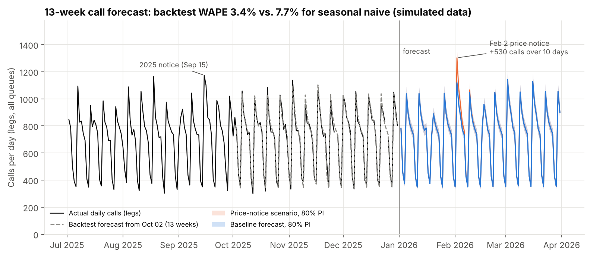
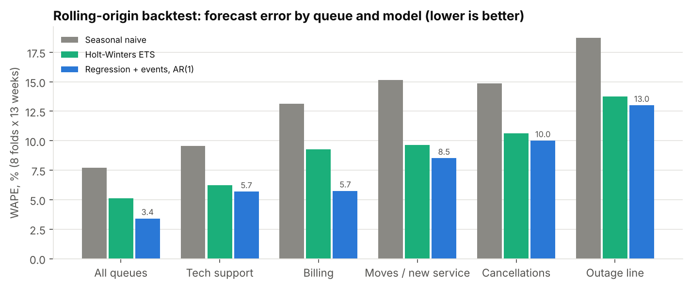
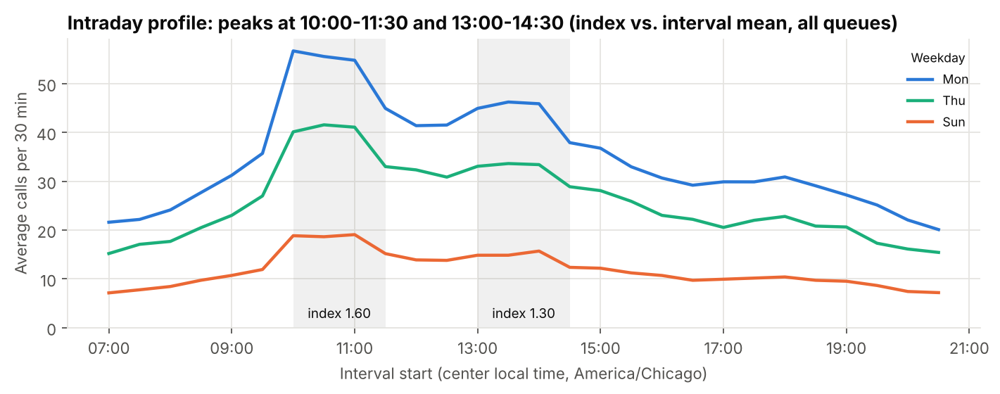
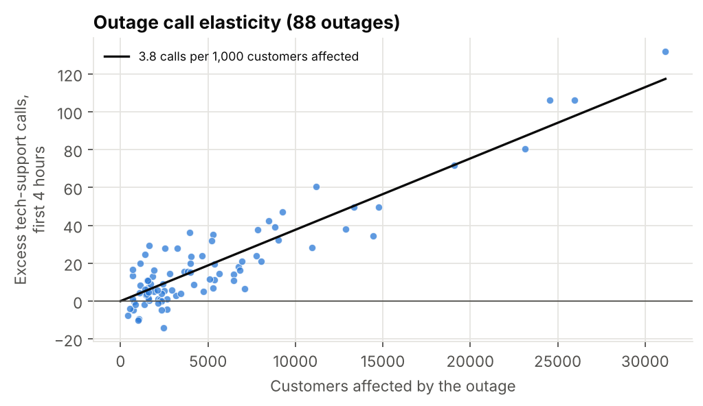
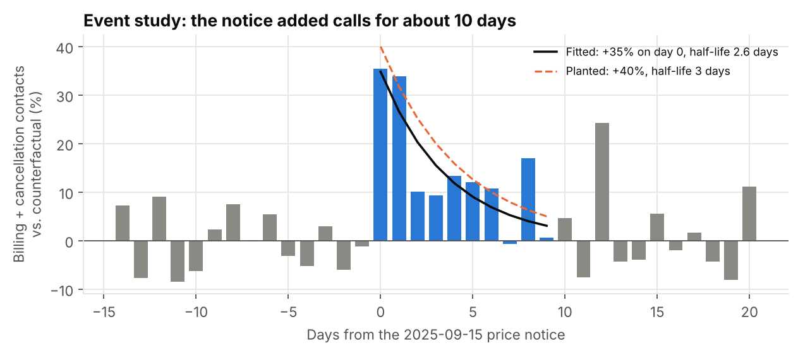
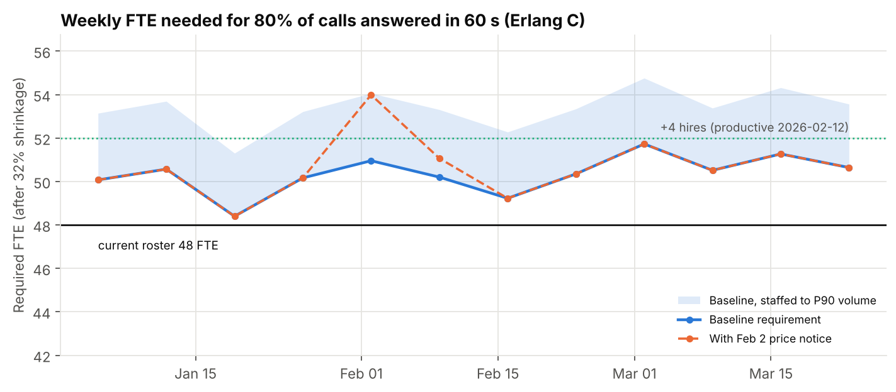
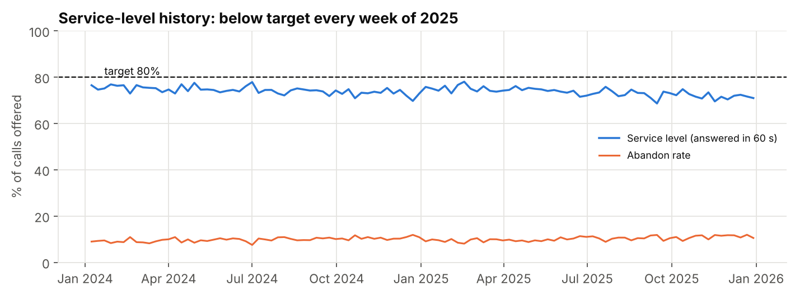
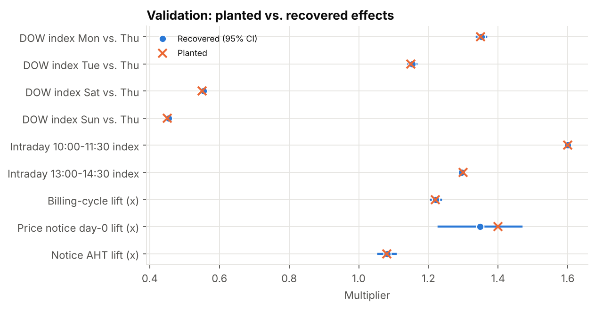

# Contact-Center Volume Forecast and Staffing Plan

**Business question:** How many agents are needed per 30-minute interval over the next 13 weeks to answer 80% of calls within 60 seconds, and how much does the planned February price-change notice add?



## TL;DR

- **The forecast beats a seasonal-naive baseline by 56%.** WAPE is 3.4% vs. 7.7% (MASE 0.52 vs. 1.18), measured over 8 rolling origins with 13-week horizons. The 80% prediction intervals covered 80% of actual days.
- **Q1 2026 needs 50.3 FTE on average against a roster of 48.** The roster falls short in 12 of 12 full weeks, starting the week of 2026-01-05. With 6 weeks of training, the hire-by date was 2025-11-24. **Recommendation: hire 4 agents now (productive from 2026-02-12) and cover the gap with overtime.**
- **The Feb 2 price notice adds about 530 calls over 10 days** and pushes the requirement to 54.0 FTE in the week of 2026-02-02 (+3.0 FTE). The overtime budget is $16,811 for the quarter, of which $4,028 (106 hours at $38) is for the notice.
- **Service level has been below the 80% target every week of 2025** (73.4% answered within 60 s; 10.2% abandoned). The schedule did not keep up with 0.62% monthly growth.

> **Synthetic data notice.** All data in this repository is synthetic, generated by `src/generate_data.py` (seed 42). No real patients, members, customers, or organizations. Findings describe the simulated system, not any real company.

## Business context (simulated)

The Director of Customer Care at a simulated regional home-internet provider has to approve the Q1 2026 hiring plan: how many FTE, hired by when given a 6-week training lead time. The director also has to set an overtime budget for the surge after the February price-change notice. The center runs five queues (billing, tech support, moves/new service, cancellations, outage line), 07:00-21:00 Central, 7 days a week. The service-level goal is 80% of calls answered within 60 seconds.

## Skills demonstrated

- Time-series forecasting: seasonal naive, Holt-Winters ETS, and regression with event regressors and AR(1) errors (statsmodels SARIMAX)
- Honest evaluation: rolling-origin backtest (8 folds x 13 weeks), WAPE and MASE against seasonal naive, 80% prediction-interval coverage
- Event and scenario modeling: an event study with a fitted decay curve, outage elasticity, billing-cycle effects
- Capacity planning: Erlang C written from scratch ([`src/erlang.py`](src/erlang.py)), interval-level agent requirements, shrinkage, FTE, hiring date, overtime cost
- SQL (DuckDB, written to port to PostgreSQL): `AT TIME ZONE` conversions, window functions, range joins, a `VALUES` mapping table, calendar marts
- Data cleaning: mixed UTC/local timestamps, DST artifacts, renamed queue codes, missing days, contacts vs. legs

## Approach

1. **Generate** seven tables (484,516 call legs, 175,440 staffing intervals, 120,000 customers, 90 outages) with planted effects and data-quality issues: [`src/generate_data.py`](src/generate_data.py).
2. **Load** into DuckDB: [`src/load.py`](src/load.py).
3. **Stage and clean**: [`sql/01_staging/`](sql/01_staging/). This step fixes time zones, maps queue codes, zeroes handle time on abandons, and collapses DST duplicates.
4. **Model marts**: [`sql/02_marts/`](sql/02_marts/). This step builds contacts (demand) vs. legs (workload), a daily feature calendar, and day-by-queue and interval-by-queue facts.
5. **Answer the questions**: [`sql/03_analysis/`](sql/03_analysis/) (interval profile, billing cycle, outage elasticity, price-notice event study, service-level history, staffing requirement).
6. **Model and size** in Python: [`src/analysis.py`](src/analysis.py) runs the effect recovery, backtest, Q1 2026 forecast, and Erlang C staffing, and writes `reports/results.json`.
7. **Report**: [`src/figures.py`](src/figures.py), [`src/dashboard.py`](src/dashboard.py) produces [`dashboard/index.html`](dashboard/index.html), and [`src/report.py`](src/report.py) fills this README from `results.json`.

**Contacts vs. legs.** A contact is one customer call. A transfer adds a second leg in another queue (4.0% of contacts). Demand is counted in contacts (465,906). Workload and staffing are counted in legs (484,516), because each leg takes an agent in its queue. The daily forecasts and Erlang C inputs use legs.

## Key findings

### 1. The regression forecast beats both baselines in every queue



| Model | WAPE (all queues) | MASE |
|---|---|---|
| Seasonal naive (repeat last week) | 7.7% | 1.18 |
| Holt-Winters ETS (damped trend, weekly seasonality) | 5.1% | 0.78 |
| Regression: trend, weekday, holidays, billing cycle, promos, price notice, expected outage load; AR(1) errors | **3.4%** | **0.52** |

The backtest uses 8 origins from 2025-03-20 to 2025-10-02, 4 weeks apart, each forecasting 13 weeks. Days that are closed or missing are not scored. Outage load uses its historical average (outages are not known in advance), so no future information leaks into the backtest. Accuracy is best for tech support (5.7%) and worst for outage (13.0%), the smallest queue.

### 2. Seasonality, billing cycles, and outages drive intraday and daily volume



- **Weekday:** Monday runs 1.35x Thursday and Sunday 0.45x (Poisson regression with trend and events).
- **Intraday:** the 10:00-11:30 intervals run 1.60x the interval mean and 13:00-14:30 runs 1.30x.
- **Billing cycle:** billing-queue contacts rise 22.2% (95% CI 20.8% to 23.5%) on days 1-3 after each bill date (the 1st and 15th).
- **Outages:** each outage adds 3.8 tech-support calls per 1,000 affected customers in the first 4 hours (95% CI 3.5 to 4.0; 88 outages).



### 3. The 2025 price notice: +35% calls on day 0, half-life 2.6 days, and longer calls



The counterfactual comes from Poisson regressions for billing and cancellations, fitted on 2025 outside the response window, with trend, weekday, billing-cycle, and holiday terms. The notice is a Monday that falls just before billing-cycle days, so a same-weekday baseline would mix the two effects. The fitted decay is +35% on day 0 (95% CI 23% to 47%) with a 2.6-day half-life (95% CI 1.1 to 4.1), for about 497 excess contacts over 10 days. Average handle time on those queues rose 8.1% for 14 days. Service level in the notice week fell to 68.6%. The 2026 scenario reuses these estimates.

### 4. Staffing: hire 4 now and budget overtime for the notice



The daily forecast is spread across intervals using each queue's weekday profile from the last 26 weeks. Each interval x queue gets Erlang C agents for 80/60 at the Q4 2025 average handle time (billing 4.9 min, tech 7.6 min). FTE = productive agent-hours / (1 - 32% shrinkage) / 40.

| | Baseline | With Feb 2 price notice |
|---|---|---|
| Q1 2026 calls (legs) | 64,415 | 64,945 |
| Peak weekly requirement | 51.7 FTE | 54.0 FTE |
| Weeks over the 48-FTE roster | 12 of 12 | 12 of 12 |
| Overtime, with 4 hires productive from 2026-02-12 | $12,783 | $16,811 |
| Overtime with no hiring | $29,043 | $33,071 |

Baseline volume is 7.3% above Q1 2025. If staffing to the P90 volume (upper 80% PI) instead of the mean, the peak baseline requirement is 54.8 FTE.

### 5. Service level has been below target, and five small queues cost capacity



The 2025 service level was 73.4% (0 of 52 weeks at or above 80%), falling to 71.9% in Q4. Occupancy averaged 38%, which is low because each of five small queues needs its own Erlang C buffer. If one cross-trained team answered all queues, Erlang C would need 30.1 FTE instead of 50.3, about 20.3 FTE less. That is an upper bound: it ignores cross-training cost and any AHT increase.

## Recommendations

1. **Open 4 requisitions now** (Finding 4). The 6-week hire-by date (2025-11-24) has already passed, so new hires are productive from 2026-02-12 at the earliest.
2. **Approve an overtime budget of $16,811 for Q1**, including $4,028 for the week of 2026-02-02 and the week after (Findings 3 and 4). Schedule the overtime in the 10:00-11:30 and 13:00-14:30 peaks on Feb 2-6, when billing and cancellation calls run highest.
3. **Pilot cross-training between billing and cancellations, the two queues the price notice hits** (Finding 5). Pooling cuts the Erlang C buffer. Re-run this model monthly with the latest actuals, and track WAPE against the seasonal-naive benchmark.

## Validation: planted vs. recovered

The generator writes its parameters and realized values to [`data/truth/planted_effects.json`](data/truth/planted_effects.json). `tests/test_validation.py` asserts these checks.



| Effect | Planted parameter | Realized in generated data | Recovered (95% CI) | Inside CI? |
|---|---|---|---|---|
| Day-of-week index, Mon vs. Thu | 1.35 | - | 1.353 (1.339 to 1.366) | yes |
| Day-of-week index, Tue vs. Thu | 1.15 | - | 1.154 (1.142 to 1.165) | yes |
| Day-of-week index, Wed vs. Thu | 1.05 | - | 1.054 (1.044 to 1.064) | yes |
| Day-of-week index, Fri vs. Thu | 0.95 | - | 0.949 (0.940 to 0.959) | yes |
| Day-of-week index, Sat vs. Thu | 0.55 | - | 0.554 (0.548 to 0.561) | yes |
| Day-of-week index, Sun vs. Thu | 0.45 | - | 0.455 (0.448 to 0.461) | yes |
| Intraday index 10:00-11:30 | 1.60 | - | 1.600 | yes (within 0.03) |
| Intraday index 13:00-14:30 | 1.30 | - | 1.296 | yes (within 0.03) |
| Trend per month | 0.60% | - | 0.62% (0.58% to 0.66%) | yes |
| Billing-cycle lift, days 1-3 after bill date | 22.0% | - | 22.2% (20.8% to 23.5%) | yes |
| Outage calls per affected customer | 0.0040 | 0.0040 | 0.0038 (0.0035 to 0.0040) | yes |
| Price-notice lift, day 0 | 40% | - | 35% (23% to 47%) | yes |
| Price-notice half-life (days) | 3.0 | - | 2.6 (1.1 to 4.1) | yes |
| Price-notice AHT lift (14 days) | 8% | 8.1% | 8.1% (5.7% to 10.6%) | yes |
| Contacts split into 2 legs by transfer | 4% | 4.0% | 4.0% | yes |
| Abandoned legs with handle time > 0 | 0.6% of abandons | 284 | 284 fixed | yes |
| 'TS' alias rows for tech support | 15% of post-IVR tech legs | 9,418 | 9,418 mapped | yes |
| Missing days | 2024-08-12, 2024-08-13 | - | 2024-08-12, 2024-08-13 | yes |

## Data-quality issues found and how they were handled

| Issue (planted) | Found | Handling |
|---|---|---|
| `arrival_ts` stored as local time (not UTC) from 2024-01-01 to 2024-03-31 | 55,969 legs; read as UTC, 25,079 would fall outside opening hours | Rows before the 2024-04-01 migration converted local -> UTC in `02_stg_call_leg.sql` |
| DST: repeated 01:00/01:30 in November, missing 02:00/02:30 in March (staffing table, local time) | 20 duplicate rows in 175,440 | Collapsed with `MAX` on (interval, queue); both fall in closed hours |
| Queue codes renamed at the 2025-05-01 IVR change, plus a 'TS' alias | 11 raw codes, 9,418 'TS' rows | Mapping table `ref_queue_code`; 0 unmapped rows |
| Transfers split contacts into legs | 4.0% of contacts | Demand = contacts (`fct_contact`); workload = legs |
| ETL failure: no data for 2024-08-12, 2024-08-13 | 2 days | Left missing (NaN) in the regression model, imputed only for naive/ETS inputs, never scored |
| Abandoned legs with `handle_time_sec` > 0 | 284 legs (0.6% of abandons) | Set to 0 and flagged |

## How to reproduce

```bash
pip install -r requirements.txt
make all      # generate -> load -> clean -> analyze -> figures -> dashboard -> report (about 1 minute)
pytest -q
```

No network access is needed. Outputs: `reports/results.json`, `figures/`, `dashboard/index.html`, `powerbi/`.

## Limitations and next steps

- The data is synthetic. Seasonality, event sizes, and costs are assumptions chosen for the exercise.
- History is only two years, so annual seasonality is not modeled. A third year would allow annual Fourier terms.
- Erlang C assumes no abandonment and Poisson arrivals within each interval. It overstates agents when abandonment is high. Erlang A or simulation is the next step.
- The FTE math assumes perfect schedule fit: weekly agent-hours / productive hours. Real shift patterns add 5-10%. A schedule optimizer would close that gap.
- The price-notice effect is estimated from a single 2025 event. The 2026 notice could differ in size, which is why the P90 staffing view is shown.
- Roster deviation: the brief's 118-FTE roster implies roughly 5x the call volume that fits in the 500k-row fact table. The roster is set to 48 FTE, which matches the simulated Q4 2025 schedule.

## Repo map

```
README.md                      this file (generated by src/report.py from docs/templates/)
Makefile                       make all = generate -> load -> clean -> analyze -> figures -> dashboard -> report
src/config.py                  planning assumptions (SL target, shrinkage, roster, OT rate, training weeks)
src/erlang.py                  Erlang B/C, service level, agents required (implemented from scratch)
src/generate_data.py           synthetic data generator (seed 42) + truth file
src/load.py                    CSV -> DuckDB raw tables; runs staging and marts SQL
src/analysis.py                effect recovery, backtest, forecast, staffing -> reports/results.json
src/figures.py                 PNG charts -> figures/
src/dashboard.py               self-contained Plotly dashboard -> dashboard/index.html
src/report.py                  fills README and executive summary from results.json
src/export_powerbi.py          star-schema CSVs for Power BI -> powerbi/
sql/01_staging/                time zones, queue codes, DST, handle-time fixes
sql/02_marts/                  contacts, daily features, day x queue, interval x queue
sql/03_analysis/               one file per business question
tests/                         data quality, Erlang C, validation vs. truth, report consistency
docs/                          data dictionary, methodology, executive summary
data/sample/                   up to 1,000 rows per raw table
data/truth/planted_effects.json generator parameters and realized values
```

## About

Built by Adedeji M. Olugboja — linkedin.com/in/adedeji-olugboja

License: MIT
